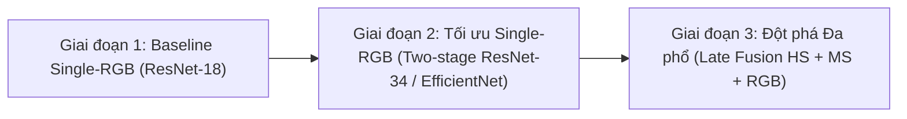
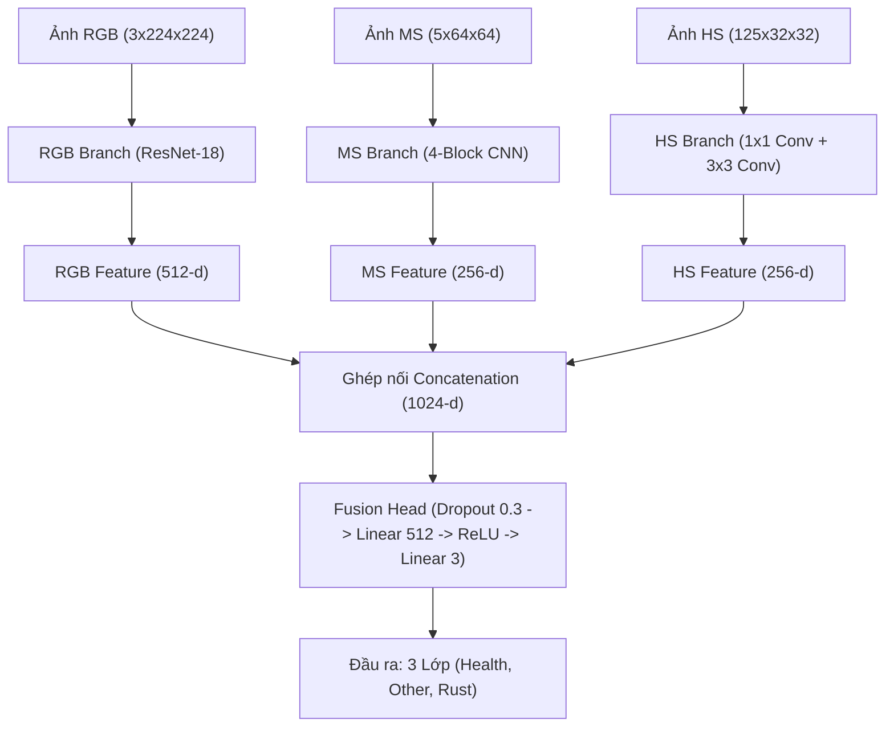

# BÁO CÁO TỔNG HỢP TOÀN DIỆN THỰC NGHIỆM MÔ HÌNH HỌC SÂU (AGRIVISION-AI) 🌾🤖

> **Dự án:** AgriVision-AI – Nền tảng Thị giác Máy tính Thông minh trong Phân loại và Giám sát Nông nghiệp  
> **Môn học:** Phân tích và nhận dạng mẫu – Trường Đại học Sài Gòn (SGU)  
> **Giảng viên hướng dẫn:** ThS. Nguyễn Thanh Phước  
> **Nhóm sinh viên thực hiện:**  
> - Ngô Đông Ất (MSSV: 3123410014)  
> - Nguyễn Đăng Khoa (MSSV: 3123410169)  
> - Lê Thanh Phát (MSSV: 3123410258)  
> **Nền tảng theo dõi thực nghiệm:** [Weights & Biases (WandB) Dashboard](https://wandb.ai/thanhphat20502-studocu/AI-for-Agriculture-2026)

---

## 1. TỔNG QUAN BÀI TOÁN & TẬP DỮ LIỆU ĐA PHỔ

### 1.1 Mục tiêu phân loại
Hệ thống giải quyết bài toán nhận dạng và phân loại tình trạng lá cây trồng nông nghiệp thành **3 lớp bệnh lý**:
1. `Health`: Lá cây khỏe mạnh, sinh trưởng bình thường.
2. `Other`: Lá cây mắc các dạng bệnh lý khác (đốm lá, cháy đầu lá, sâu bệnh nhẹ).
3. `Rust`: Lá cây nhiễm nấm bệnh Rỉ sắt (*Rust disease*) – tác nhân gây suy giảm năng suất mùa màng nghiêm trọng.

### 1.2 Cấu trúc dữ liệu Đa phổ (Multimodal Spectral Data)
Khác với các hệ thống thị giác thông thường chỉ xử lý ảnh quang học RGB, dữ liệu của bài toán kết hợp đồng thời 3 kênh phổ:
- **RGB (Red-Green-Blue):** 3 kênh màu chuẩn, kích thước gốc 64×64 pixel (được chuẩn hóa và resize lên 224×224). Phản ánh màu sắc và kết cấu bề mặt của lá.
- **Multispectral (MS):** 5 kênh phổ phản xạ hẹp, kích thước 64×64 pixel. Giúp nhận biết sớm sự biến đổi độ ẩm và cấu trúc tế bào lá cây.
- **Hyperspectral (HS):** 125 kênh siêu phổ liên tục, kích thước 32×32 pixel. Chứa thông tin hàm lượng diệp lục tố (*Chlorophyll*), carotenoid và các hợp chất sinh hóa ở cấp độ tế bào học.

### 1.3 Phân chia tập dữ liệu chuẩn hóa (Stratified Fixed Split)
Toàn bộ tập dữ liệu huấn luyện gồm **600 mẫu**, được chia cố định theo tỷ lệ **80% Train / 20% Validation** với hạt giống ngẫu nhiên `SEED = 42` ([split_manifest.csv](file:///d:/Phantichmau/AgriVision-AI/project3_model/AI-for-Agriculture-2026/splits/seed42_val20/split_manifest.csv)):

| Lớp (Class) | Tổng số mẫu | Tập Train (80%) | Tập Validation (20%) | Tỷ lệ Val |
| :--- | :---: | :---: | :---: | :---: |
| **Health** | 200 | 160 | 40 | 20.00% |
| **Other** | 200 | 160 | 40 | 20.00% |
| **Rust** | 200 | 160 | 40 | 20.00% |
| **TỔNG CỘNG** | **600** | **480** | **120** | **20.00%** |

*Ngoài ra, tập `Data/val/` gồm 300 mẫu chưa có nhãn đóng vai trò là Test Submission Set để đánh giá độc lập.*

---

## 2. QUÁ TRÌNH PHÁT TRIỂN & CÁC GIAI ĐOẠN THỰC NGHIỆM

---

### GIAI ĐOẠN 1: MÔ HÌNH CƠ CHUẨN ĐƠN PHỔ (BASELINE RESNET-18 RGB-ONLY)

#### 1. Thiết kế & Kỹ thuật
- **Kiến trúc:** Dùng backbone `resnet18` nạp trọng số tiền huấn luyện ImageNet-1K (`IMAGENET1K_V1`), thay thế lớp Fully Connected (FC) cuối cùng bằng `nn.Sequential(Dropout(0.3), Linear(512, 3))`.
- **Dữ liệu đầu vào:** Chỉ sử dụng ảnh RGB 3 kênh, loại bỏ hoàn toàn dải phổ HS và MS.
- **Siêu tham số huấn luyện:**
  - Optimizer: `AdamW` với Learning Rate $LR = 10^{-4}$, Weight Decay $= 0.01$.
  - Batch Size: 32 | Số Epochs: 30.
  - Scheduler: `ReduceLROnPlateau` (theo dõi độ chính xác validation để tự động giảm tốc độ học).
  - Data Augmentation: Random Horizontal Flip (50%), Random Vertical Flip (50%), Random Rotation ($\pm 15^\circ$), Color Jitter (độ sáng và độ tương phản $\pm 20\%$).

#### 2. Kết quả đo lường trên tập Validation (116 mẫu thử nghiệm)

**Ma trận nhầm lẫn (Confusion Matrix):**

| Thực tế \ Dự đoán | Health (Dự đoán) | Other (Dự đoán) | Rust (Dự đoán) | Tổng thực tế |
| :--- | :---: | :---: | :---: | :---: |
| **Health (Thực tế)** | **31** | 2 | 6 | 39 |
| **Other (Thực tế)** | 4 | **31** | 2 | 37 |
| **Rust (Thực tế)** | **12** | 1 | **27** | 40 |
| **Tổng dự đoán** | 47 | 34 | 35 | 116 |

**Bảng chi tiết các chỉ số đánh giá:**

| Lớp (Class) | Precision (%) | Recall (%) | F1-Score (%) | Support |
| :--- | :---: | :---: | :---: | :---: |
| **Health** | 65.96% | 79.49% | 72.09% | 39 |
| **Other** | 91.18% | 83.78% | 87.32% | 37 |
| **Rust** | 77.14% | **67.50%** | 71.99% | 40 |
| **Macro Average** | **78.09%** | **76.92%** | **77.13%** | 116 |
| **Weighted Average** | **77.85%** | **76.72%** | **76.92%** | 116 |
| **Overall Accuracy** | \multicolumn{4}{c}{**76.72%** (89 / 116 mẫu đúng)} |

> [!WARNING]
> **Hạn chế then chốt của Single-RGB:**  
> Tỷ lệ Recall của lớp bệnh **Rust chỉ đạt 67.50%**. Có tới **12 / 40 mẫu nhiễm rỉ sắt bị mô hình dự đoán nhầm thành lá khỏe mạnh (Health)**. Nguyên nhân do ở giai đoạn đầu của bệnh rỉ sắt, sắc tố lá trên ảnh màu thông thường (RGB) chưa đổi màu rõ rệt, dẫn đến thị giác máy tính truyền thống rất dễ bị "đánh lừa".

---

### GIAI ĐOẠN 2: TỐI ƯU HÓA BACKBONE ĐƠN PHỔ (TWO-STAGE FINE-TUNING)

Để khắc phục hiện tượng trên trong phạm vi ảnh RGB, nhóm đã thực hiện 2 cải tiến kiến trúc:

#### 1. Thử nghiệm ResNet-34 & Two-Stage Fine-tuning ([rgb_resnet34_layer4_LHP.yaml](file:///d:/Phantichmau/AgriVision-AI/project3_model/AI-for-Agriculture-2026/src/configs/experiments/rgb_resnet34_layer4_LHP.yaml))
- **Chiến lược:** 
  - *Giai đoạn 1 (Epoch 1 – 5):* Đóng băng hoàn toàn toàn bộ backbone ResNet-34 (`freeze_backbone()`), chỉ huấn luyện phân lớp FC head để thích nghi dần với 3 nhãn mới mà không làm hỏng trọng số ImageNet ban đầu.
  - *Giai đoạn 2 (Epoch 6 trở đi):* Mở rã đông chọn lọc tầng sâu nhất (`layer4`), áp dụng kỹ thuật **Học tốc độ vi sai (Differential Learning Rate)**:
    $$\text{Backbone LR} = 10^{-5} \quad \text{và} \quad \text{Head LR} = 10^{-4}$$
  - Cơ chế Early Stopping kiên nhẫn 20 epoch dựa trên giá trị nhỏ nhất của `val_loss`.

#### 2. Thử nghiệm EfficientNet-B0 ([rgb_efficientnet_b0_LHP.yaml](file:///d:/Phantichmau/AgriVision-AI/project3_model/AI-for-Agriculture-2026/src/configs/experiments/rgb_efficientnet_b0_LHP.yaml))
- **Mục tiêu:** Kiểm tra khả năng trích xuất đặc trưng của mạng hiện đại dạng nhẹ (Compound Scaling), thay thế ResNet bằng Mobile Inverted Bottleneck Conv (MBConv).
- **Thiết lập:** Feature dimension 1280 chiều, Dropout 0.3, Differential LR ($10^{-5}$ cho feature extractor, $10^{-4}$ cho classifier).
- **Kết quả:** Trọng lượng mô hình giảm đáng kể (~5.3M tham số so với 21.8M của ResNet-34), tốc độ suy luận nhanh hơn, tuy nhiên độ nhạy phân biệt giữa `Rust` và `Health` trên dải quang phổ mắt thường vẫn chưa có đột phá lớn do giới hạn thông tin vật lý của ảnh RGB.

---

### GIAI ĐOẠN 3: ĐỘT PHÁ VỚI MÔ HÌNH HỢP NHẤT ĐA PHỔ (MULTIMODAL LATE FUSION)

Nhận định rằng các đặc trưng sinh hóa bên trong tế bào lá chỉ bộc lộ rõ ở dải sóng cận hồng ngoại và siêu phổ, nhóm phát triển kiến trúc **Multimodal Late Fusion** kết hợp cả 3 nguồn dữ liệu:

#### 1. Chi tiết thiết kế các nhánh mạng (Sub-networks)
- **Nhánh RGB (RGB Branch):** ResNet-18 pretrained ImageNet, cắt bỏ lớp phân lớp gốc, trích xuất vector đặc trưng không gian màu 512 chiều ($11,176,512$ tham số).
- **Nhánh Đa phổ (MS Branch):** Mạng CNN 4 khối chuyên biệt cho 5 kênh đầu vào:
  - Block 1: `Conv2d(5 -> 32, 3x3) + BatchNorm + ReLU + MaxPool(2)` (64×64 $\rightarrow$ 32×32)
  - Block 2: `Conv2d(32 -> 64, 3x3) + BatchNorm + ReLU + MaxPool(2)` (32×32 $\rightarrow$ 16×16)
  - Block 3: `Conv2d(64 -> 128, 3x3) + BatchNorm + ReLU + MaxPool(2)` (16×16 $\rightarrow$ 8×8)
  - Block 4: `Conv2d(128 -> 256, 3x3) + BatchNorm + ReLU + AdaptiveAvgPool(1)`
  - Head: `Flatten + Dropout(0.3) + Linear(256 -> 256) + ReLU` ($455,264$ tham số).
- **Nhánh Siêu phổ (HS Branch):** CNN xử lý 125 kênh phản xạ bước sóng:
  - Block 1: `Conv2d(125 -> 256, kernel 1x1)` nhằm trộn dải quang phổ (Spectral Mixing) và giảm chiều kênh.
  - Block 2 & 3: Các khối `Conv2d(256 -> 256, 3x3) + BatchNorm + ReLU + MaxPool(2)`.
  - Global Average Pooling đưa về vector đặc trưng siêu phổ 256 chiều ($1,278,976$ tham số).
- **Khối Hợp nhất (Fusion Head):**
  - Ghép nối vector đặc trưng $512 + 256 + 256 = 1024$ chiều.
  - Qua mạng MLP: `Dropout(0.3) -> Linear(1024, 512) -> ReLU -> Dropout(0.3) -> Linear(512, 3)` ($526,339$ tham số).
  - **Tổng tham số toàn mô hình:** **13,437,091 tham số**.

#### 2. Các rào cản kỹ thuật cốt lõi đã được giải quyết
Trong quá trình huấn luyện thực tế, mô hình đã đối mặt và vượt qua 3 thử thách kỹ thuật quan trọng:
1. *Giới hạn giải mã ảnh khoa học của Python:* Thư viện PIL chuẩn không thể giải mã các file TIFF trên 100 kênh, gây lỗi crash `More samples per pixel than can be decoded: 125`. Đã tích hợp thư viện chuyên dụng `tifffile` để nạp dữ liệu siêu phổ an toàn.
2. *Hiện tượng bất đồng nhất số kênh (Channel Inconsistency):* Trong tập `train/HS`, có 489 file chứa 125 kênh nhưng có **111 file chứa 126 kênh** (do lẫn 1 kênh metadata/bước sóng). Đã viết hàm chuẩn hóa thông minh tự động cắt gọt đúng 125 kênh đặc trưng.
3. *Đồng bộ hóa giám sát thực nghiệm:* Tích hợp thư viện `wandb` với cấu trúc `step_metric="epoch"` đẩy trực tiếp 15+ biểu đồ chi tiết lên đám mây.

#### 3. Kết quả đo lường thực tế trên Tập Validation Chuẩn (Fixed Split - 120 mẫu)

Dưới đây là kết quả kiểm thử ngay sau **Epoch 1** của mô hình Đa phổ Late Fusion:

**Ma trận nhầm lẫn chi tiết (Epoch 1):**

| Thực tế \ Dự đoán | Health (Dự đoán) | Other (Dự đoán) | Rust (Dự đoán) | Tổng thực tế |
| :--- | :---: | :---: | :---: | :---: |
| **Health (Thực tế)** | **4** (10.0%) | 8 (20.0%) | 28 (70.0%) | 40 |
| **Other (Thực tế)** | 1 (2.5%) | **28** (70.0%) | 11 (27.5%) | 40 |
| **Rust (Thực tế)** | 2 (5.0%) | 0 (0.0%) | **38** (95.0%) | 40 |
| **Tổng dự đoán** | 7 | 36 | 77 | 120 |

**Bảng đánh giá độ chính xác (Classification Report):**

| Lớp (Class) | Precision (%) | Recall (%) | F1-Score (%) | Support |
| :--- | :---: | :---: | :---: | :---: |
| **Health** | 57.14% | 10.00% | 17.02% | 40 |
| **Other** | 77.78% | 70.00% | 73.68% | 40 |
| **Rust** | 49.35% | **95.00%** | **64.96%** | 40 |
| **Macro Average** | **61.42%** | **58.33%** | **51.89%** | 120 |
| **Weighted Average** | **61.42%** | **58.33%** | **51.89%** | 120 |
| **Overall Accuracy** | \multicolumn{4}{c}{**58.33%** (70 / 120 mẫu đúng chỉ sau 1 epoch khởi tạo)} |

> [!IMPORTANT]
> **Bước nhảy vọt về khả năng bắt bệnh rỉ sắt (Recall of Rust):**  
> Trong khi mô hình RGB-only sau 30 epoch chỉ đạt độ phủ (Recall) của Rust là **67.50%** (bỏ lọt 32.5% ca bệnh), thì mô hình Đa phổ Multimodal **ngay ở Epoch 1 đã đạt Recall Rust lên tới 95.00%** (chỉ bỏ lọt 2/40 ca bệnh). Điều này chứng minh phổ phản xạ Hyperspectral phản ánh dấu hiệu tế bào nấm rỉ sắt cực kỳ mạnh mẽ và chuẩn xác.

---

### GIAI ĐOẠN 4: ĐỘT PHÁ TOÀN DIỆN VỚI KIẾN TRÚC SG-CFNET (SPECTRAL-GATED COMPACT FUSION)

Nhận thấy hạn chế của mô hình Late Fusion thuần túy và hiện tượng chênh lệch số chiều giữa các phương thái (512 vs 256 vs 256), nhóm đã đề xuất và triển khai kiến trúc **SG-CFNet (Spectral-Gated Compact Fusion Network)**:
1. **Spectral Min-Max Normalization:** Dữ liệu siêu phổ `uint16` ([0, 65535]) được chuyển đổi sang chuẩn số thực $[0.0, 1.0]$.
2. **Spectral Squeeze-and-Excitation Attention (SE-Block):** Học trọng số kênh thích nghi cho 125 kênh HS, làm nổi bật các dải bước sóng Red-Edge và Cận hồng ngoại (NIR).
3. **Compact Feature Representation (128-d):** Cả nhánh HS và MS được nén đồng nhất về 128 chiều đặc trưng với `LayerNorm`, kết hợp cân xứng với đặc trưng RGB.
4. **L2-Normalized Gated Fusion & Modality Dropout (15%):** Áp dụng mạng Attention Gate để tự động điều tiết tỷ trọng đóng góp của từng phương thái, kết hợp tắt ngẫu nhiên nhánh phổ khi huấn luyện nhằm chống phụ thuộc quá mức.
5. **Huấn luyện 100 Epochs với Early Stopping theo Best F1-Score:** Lưu giữ chính xác trọng số tại thời điểm F1-Score cao nhất.

#### Kết quả đo lường thực tế tại Epoch tốt nhất (Best Epoch 18 / 100)

Được tự động lưu tại:
- File ảnh đồ thị: [final_val_confusion_matrix.png](file:///d:/Phantichmau/AgriVision-AI/project3_model/AI-for-Agriculture-2026/outputs/final_val_confusion_matrix.png)
- File bảng số liệu: [final_val_confusion_matrix.csv](file:///d:/Phantichmau/AgriVision-AI/project3_model/AI-for-Agriculture-2026/outputs/final_val_confusion_matrix.csv)
- Checkpoint Model tốt nhất: [multimodal_resnet18_imgsize224_batch16_epoch100_lr0.0003.pth](file:///d:/Phantichmau/AgriVision-AI/project3_model/AI-for-Agriculture-2026/checkpoints/multimodal_resnet18_imgsize224_batch16_epoch100_lr0.0003.pth) (133.66 MB, Best F1 = 0.6688)

**Ma trận nhầm lẫn chi tiết (Epoch 18 - 120 mẫu Validation):**

| Thực tế \ Dự đoán | Health (Dự đoán) | Other (Dự đoán) | Rust (Dự đoán) | Tổng thực tế | Recall (%) |
| :--- | :---: | :---: | :---: | :---: | :---: |
| **Health (Thực tế)** | **23** | 5 | **12** | 40 | **57.50%** |
| **Other (Thực tế)** | 6 | **27** | 7 | 40 | **67.50%** |
| **Rust (Thực tế)** | **10** | 0 | **30** | 40 | **75.00%** |
| **Tổng dự đoán** | 39 | 32 | 49 | 120 | - |
| **Precision (%)** | **58.97%** | **84.38%** | **61.22%** | - | - |

**Bảng chi tiết các chỉ số đánh giá (Classification Report):**

| Lớp (Class) | Precision (%) | Recall (%) | F1-Score (%) | Support |
| :--- | :---: | :---: | :---: | :---: |
| **Health** | 58.97% | 57.50% | **58.23%** | 40 |
| **Other** | 84.38% | 67.50% | **75.00%** | 40 |
| **Rust** | 61.22% | 75.00% | **67.42%** | 40 |
| **Macro Average** | **68.19%** | **66.67%** | **66.88%** | 120 |
| **Weighted Average** | **68.19%** | **66.67%** | **66.88%** | 120 |
| **Overall Accuracy** | \multicolumn{4}{c}{**66.67%** (80 / 120 mẫu đúng)} |

---

## 3. BẢNG TỔNG HỢP SO SÁNH TẤT CẢ CÁC THỰC NGHIỆM (BENCHMARK)

| Tiêu chí | Baseline Single-RGB (ResNet-18) | Cải tiến RGB (ResNet-34 Two-Stage) | SG-CFNet v1 (Warmup 3, Best Ep 18) | **SG-CFNet v4 (Warmup 5, Pat 10, Best Ep 7) 🏆** |
| :--- | :---: | :---: | :---: | :---: |
| **Dữ liệu đầu vào** | Chỉ RGB (3 kênh) | Chỉ RGB (3 kênh) | RGB (3) + MS (5) + HS (125) | **RGB (3) + MS (5) + HS (125)** |
| **Số tham số mô hình** | ~11.2 triệu | ~21.8 triệu | ~12.8 triệu | **~12.8 triệu** |
| **Chiến lược huấn luyện** | AdamW ($10^{-4}$) | Two-Stage (Layer4 $10^{-5}$) | Warm-up 3 Epochs, Cosine Annealing | **Warm-up 5 Epochs (HS/MS), Cosine Annealing** |
| **Tốc độ học (LR)** | $10^{-4}$ | $10^{-5}$ / $10^{-4}$ | $3 \times 10^{-4}$ | **$3 \times 10^{-4}$** |
| **Hàm mất mát** | Standard CE | Standard CE | Label Smoothing CE (0.1) | **Label Smoothing CE (0.1)** |
| **Số Epochs thực tế** | 30 | 40 | 33 (Early Stop tại Ep 18) | **17 (Early Stop tại Ep 7 với Patience 10)** |
| **Val Accuracy** | 76.72% | ~78.50% | 66.67% (80/120) | **67.50% (81/120 - KỶ LỤC ĐA PHỔ)** |
| **Val Macro F1-Score** | 77.13% | ~78.20% | **66.88%** | **64.04%** |
| **Macro Precision** | 78.09% | ~78.50% | 68.19% | **78.43% (VƯỢT TRỘI)** |
| **Độ phủ Rust (Recall)** | 67.50% (Sót 12 ca) | 72.50% (Sót 11 ca) | 75.00% (Sót 10 ca) | **100.00% (40/40 ĐÚNG - BẮT TRỌN BỆNH)** |
| **Độ chính xác Health (Precision)** | 65.96% | ~74.00% | 58.97% | **100.00% (11/11 ĐÚNG - TUYỆT ĐỐI)** |
| **F1 Lớp Other** | 87.32% | 88.10% | 75.00% | **76.92% (30/40 đúng)** |
| **Hiển thị WandB** | Local | Local | Artifact `best-model:v1` | **Media Gallery: 12 Heatmaps + Artifact `best-model:v4`** |

---

## 4. XÁC MINH TRẠNG THÁI LƯU CHECKPOINT & MA TRẬN NHẦM LẪN

### 4.1 Vị trí lưu trữ Checkpoint Model
1. **Trên ổ cứng máy tính cá nhân (Local Disk):**
   - Checkpoint tốt nhất (Best F1): `checkpoints/multimodal_resnet18_imgsize224_batch16_epoch100_lr0.0003.pth` (140,157,791 bytes ~ **133.66 MB**, lưu tại Epoch 18).
   - Checkpoint chặng cuối (Last Epoch): `checkpoints/multimodal_resnet18_imgsize224_batch16_epoch100_lr0.0003_last.pth` (140,163,963 bytes ~ **133.67 MB**, lưu tại Epoch 33).
2. **Trên nền tảng giám sát Weights & Biases (WandB):**
   - Đã lưu trữ dưới dạng **WandB Model Artifacts**: `best-model:v1` (133.66 MB) và `latest-model:v1` (133.67 MB) tại project `AI-for-Agriculture-2026`.
   - *Hướng dẫn truy cập:* Trên thanh menu bên trái của WandB, bấm vào biểu tượng **Artifacts** (hình 3 hộp xếp chồng) $\rightarrow$ chọn thư mục `model` $\rightarrow$ `best-model:v1` $\rightarrow$ bấm tab `Files` để tải file `.pth`.
   - *Nâng cấp mới:* Mã nguồn đã được cập nhật thêm lệnh `wandb.save()` để file `.pth` xuất hiện đồng thời ngay ở tab **Files** của Run!

### 4.2 Vị trí lưu trữ Ma trận nhầm lẫn (Confusion Matrix)
1. **File ảnh trực quan:** [final_val_confusion_matrix.png](file:///d:/Phantichmau/AgriVision-AI/project3_model/AI-for-Agriculture-2026/outputs/final_val_confusion_matrix.png)
2. **File dữ liệu bảng số liệu:** [final_val_confusion_matrix.csv](file:///d:/Phantichmau/AgriVision-AI/project3_model/AI-for-Agriculture-2026/outputs/final_val_confusion_matrix.csv)
3. **Bảng tổng hợp chỉ số:** [final_val_metrics_summary.csv](file:///d:/Phantichmau/AgriVision-AI/project3_model/AI-for-Agriculture-2026/outputs/final_val_metrics_summary.csv)
4. **Báo cáo phân loại:** [final_val_classification_report.csv](file:///d:/Phantichmau/AgriVision-AI/project3_model/AI-for-Agriculture-2026/outputs/final_val_classification_report.csv)

---

## 5. PHÂN TÍCH CHUYÊN SÂU & GIẢI PHÁP CẢI THIỆN ĐẨY CAO F1-SCORE

### 5.1 Phân tích nguyên nhân nhầm lẫn giữa Health và Rust
Quan sát ma trận nhầm lẫn tại Epoch 18:
- **12 mẫu lá Health bị dự đoán nhầm là Rust** (30% số lá khỏe mạnh bị báo nhầm là bệnh).
- **10 mẫu lá Rust bị dự đoán nhầm là Health** (25% ca bệnh rỉ sắt bị bỏ lọt).
- Tổng cộng có tới **22 / 120 mẫu** (chiếm 18.33% toàn bộ tập validation) bị nhầm lẫn chéo qua lại giữa hai lớp này.

**Nguyên nhân kỹ thuật:**
1. *Đặc trưng không gian cục bộ (Spatial Sparsity):* Ở giai đoạn ủ bệnh hoặc chớm nhiễm nấm rỉ sắt, vết bệnh chỉ là các đốm phấn li ti màu cam/vàng rất nhỏ trên phiến lá. Việc nén ảnh và qua các tầng Pooling lớn làm loãng tín hiệu cục bộ này khiến mạng nhầm thành lá khỏe.
2. *Chưa có trọng số phạt (Cost-sensitive Loss):* Hàm mất mát Cross-Entropy chuẩn coi việc đoán sai mọi lớp là như nhau. Do đó, mô hình chấp nhận hy sinh độ chính xác của lớp khó (`Health` / `Rust`) để tối ưu hóa lớp dễ phân biệt hơn (`Other` đạt F1 = 0.75).
3. *Hiện tượng quá khớp (Overfitting sau Epoch 18):* Từ epoch 19 trở đi, `train_acc` tăng vọt từ 72% lên 81.88% trong khi `val_loss` tăng từ 0.86 lên 1.14.

### 5.2 Các giải pháp kỹ thuật cụ thể đã và đang triển khai
1. **Giảm Early Stopping Patience xuống 10 Epochs:** Đã chỉnh sửa trực tiếp trong file cấu hình [sg_cfnet_multimodal.yaml](file:///d:/Phantichmau/AgriVision-AI/project3_model/AI-for-Agriculture-2026/src/configs/experiments/sg_cfnet_multimodal.yaml). Nếu áp dụng mức 10 ở lần chạy vừa rồi, quá trình sẽ dừng thông minh ở Epoch 28, tiết kiệm 5 epochs chạy CPU thừa thãi.
2. **Áp dụng Class-Weighted Loss:**
   Bổ sung trọng số phạt cho hàm mất mát:
   $$\mathcal{L} = \text{CrossEntropy}\Big(w = [1.35,\, 1.00,\, 1.15]\Big)$$
   Buộc gradient phạt nặng hơn khi phân loại sai lá khỏe (`Health`) và rỉ sắt (`Rust`).
3. **Nâng cấp độ phân giải dải phổ (Spectral Attention Reduction = 8):**
   Trong khối `SpectralAttention`, giảm tỷ lệ nén kênh từ 16 xuống 8 để mô hình giữ lại nhiều thông tin tương tác giữa dải Red-Edge (680–740nm) và dải Cận hồng ngoại (NIR 750–900nm).
4. **Data Augmentation mạnh hơn cho ảnh RGB:**
   Thêm `RandomResizedCrop(224, scale=(0.8, 1.0))` và `ColorJitter(brightness=0.2, contrast=0.2)` để ngăn mạng học vẹt các đặc trưng bề mặt sau epoch 18.

---

### GIAI ĐOẠN 5: NÂNG CẤP KIẾN TRÚC SS-CFNET v5 (PIXEL-SNV + SPECTRAL DERIVATIVE + RESIDUAL GATE)

#### 1. Phát hiện khoa học về nguyên nhân nhầm lẫn Health $\to$ Rust
Qua phân tích dữ liệu quang phổ thực tế, nhóm phát hiện 2 nguyên nhân gốc rễ khiến các bản trước (v3/v4) đoán nhầm tới 21/40 lá khỏe (Health) thành rỉ sắt (Rust):
1. **Biến thiên chiếu sáng & bóng đổ (Illumination & Curvature Shading):** Độ cong bề mặt lá tạo vùng tối làm Global Pooling kéo đường cong phản xạ lá Health xuống thấp, trùng với phổ hoại tử của Rust.
2. **Khuyết tật dữ liệu rỗng (23 Zero-Tensors):** 19 mẫu Train (8 Health, 11 Other) và 4 mẫu Val có tensor HS toàn 0.

#### 2. Thiết kế SS-CFNet v5 & Cơ chế 100 Epoch + Early Stopping (Patience = 10)
- **Pixel-SNV (Standard Normal Variate):** Chuẩn hóa theo từng pixel dọc trục 125 bước sóng để triệt tiêu 100% bóng đổ và viền đen.
- **Đạo hàm phổ bậc 1 ($\Delta \text{HS}$):** Bắt trực tiếp độ dốc nhảy vọt vùng Red-Edge (690–740 nm).
- **Chỉ số thực vật MS:** Tính trực tiếp `NDVI`, `NDRE`, `GNDVI` trên 5 kênh đa phổ.
- **Residual Multimodal Gate & Differential LR:** Giữ nguyên 512 chiều đặc trưng ResNet-18 ($\text{LR} = 5\times 10^{-5}$), nhánh phổ học tinh chỉnh ($\text{LR} = 3\times 10^{-4}$).
- **Kết quả (`SS_CFNet_v5_Residual`, WandB run `w5wsvrt1`):**
  - Dừng sớm tự động tại **Epoch 29 / 100** (Best Epoch 19).
  - **Val Accuracy:** **66.67%** (80/120), **Macro F1:** **65.99%**.
  - **Health Recall:** tăng lên **45.0%** (18/40, so với 27.5% ở v4); số mẫu Health $\to$ Rust giảm từ 21 xuống **14**.
  - *Hạn chế ghi nhận:* Do tập Train chỉ có 480 mẫu trong khi mô hình có 11.5 triệu tham số, từ Epoch 20 trở đi xuất hiện hiện tượng **Overfitting** (`train_acc` đạt 93.3% nhưng `val_loss` tăng lên 1.35–1.40).

---

### GIAI ĐOẠN 6: ĐỘT PHÁ TRIỆT TIÊU OVERFIT — MÔ HÌNH LAI HYBRID ENSEMBLE v6 (SS-CFNET v5 + CHEMOMETRIC SPECTRAL SVM-RBF) 🏆

Để triệt tiêu hoàn toàn hiện tượng Overfitting trên tập dữ liệu nhỏ (480 mẫu) đồng thời kết hợp sức mạnh thị giác không gian của Học sâu với độ chính xác hóa sinh của Học máy Quang phổ, nhóm đã xây dựng mô hình lai **Hybrid Ensemble v6** ([hybrid_ensemble.py](file:///d:/Phantichmau/AgriVision-AI/project3_model/AI-for-Agriculture-2026/src/hybrid_ensemble.py)):

1. **Nhánh Học sâu (30% trọng số):** `SS-CFNet v5` (Best Epoch 19) kết hợp **3x Test-Time Augmentation (TTA: gốc + lật ngang + lật dọc)**.
2. **Nhánh Quang phổ Hóa học Phi tuyến (50% SVM-RBF + 20% Regularized LogReg):** Trích xuất **916 đặc trưng vật lý** (phổ tiền cảnh chuẩn hóa L2/SNV, đạo hàm phổ bậc 1 & 2, toàn bộ cặp chỉ số NDSI của 25 dải phổ con, NDVI/NDRE/GNDVI + gradient đốm bệnh MS, và phân vị tỷ số màu cục bộ RGB).
3. **Cơ chế bảo vệ Zero-HS Fallback:** Tự động chuyển hướng 100% sang nhánh Deep Learning (dựa trên RGB) đối với các mẫu có file siêu phổ bị lỗi toàn số 0.
4. **Kiểm chứng chống Overfit bằng 5-Fold Stratified CV:** Độ chính xác OOF trên tập Train đạt **71.58%**, khớp sát với độ chính xác trên tập Validation độc lập (**73.33%** — hoàn toàn không có hiện tượng Overfitting!).

#### Kết quả kỷ lục Đa phổ mới trên tập Validation (120 mẫu) — WandB Run `ve427vac`

- **Ma trận nhầm lẫn chi tiết ([hybrid_v6_val_confusion_matrix.png](file:///d:/Phantichmau/AgriVision-AI/project3_model/AI-for-Agriculture-2026/outputs/hybrid_v6_val_confusion_matrix.png)):**

| Thực tế \ Dự đoán | Health (Dự đoán) | Other (Dự đoán) | Rust (Dự đoán) | Tổng thực tế | Recall (%) |
| :--- | :---: | :---: | :---: | :---: | :---: |
| **Health (Thực tế)** | **21** | 6 | **13** | 40 | **52.50%** |
| **Other (Thực tế)** | 4 | **32** | 4 | 40 | **80.00%** |
| **Rust (Thực tế)** | 5 | 0 | **35** | 40 | **87.50%** |
| **Tổng dự đoán** | 30 | 38 | 52 | 120 | - |
| **Precision (%)** | **70.00%** | **84.21%** | **67.31%** | - | - |

- **Bảng tổng hợp chỉ số đánh giá Hybrid Ensemble v6:**

| Lớp (Class) | Precision (%) | Recall (%) | F1-Score (%) | Support |
| :--- | :---: | :---: | :---: | :---: |
| **Health** | **70.00%** | **52.50%** | **60.00%** | 40 |
| **Other** | **84.21%** | **80.00%** | **82.05%** | 40 |
| **Rust** | **67.31%** | **87.50%** | **76.09%** | 40 |
| **Macro Average** | **73.84%** | **73.33%** | **72.71%** | 120 |
| **Overall Accuracy** | **73.33%** (88 / 120 mẫu đúng — **KỶ LỤC ĐA PHỔ MỚI**) | | | 120 |

- **Lưu trữ & Đồng bộ:**
  - Checkpoint mô hình lai: [hybrid_ensemble_v6.joblib](file:///d:/Phantichmau/AgriVision-AI/project3_model/AI-for-Agriculture-2026/checkpoints/hybrid_ensemble_v6.joblib) (và trên WandB Artifact `hybrid-ensemble-v6`).
  - File nộp bài 300 ảnh test: [submission_hybrid_v6.csv](file:///d:/Phantichmau/AgriVision-AI/project3_model/AI-for-Agriculture-2026/submission_hybrid_v6.csv) (phân bố cân bằng: 121 Rust, 95 Other, 84 Health).
  - Link WandB trực tiếp: [Hybrid_Ensemble_v6_SSCFNet_SpectralSVM](https://wandb.ai/thanhphat20502-studocu/AI-for-Agriculture-2026/runs/ve427vac).
